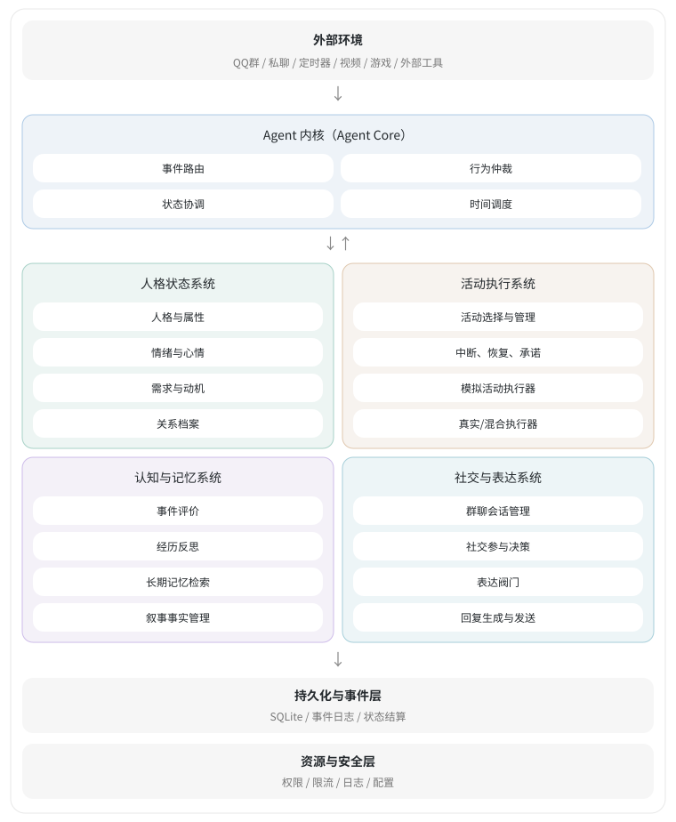

# Persona Agent v1.0

基于 AstrBot 的事件驱动、持久化状态与可插拔活动执行器的人格化 Agent。

> 本文是已确定的架构开发基线，不是已完成功能清单。当前已编写事件与结算基础、模拟活动生命周期、持久化调度、模拟活动服务，按实际经过时间计算的 NeedEngine，需求驱动的模拟活动选择，开始/继续/空闲的最小行为仲裁，VAD 情绪的时间回归与事件冲击，以及默认关闭的情绪活动偏好。自主选择、最小行为仲裁和情绪引擎已由开发者测试通过，情绪偏好评分已由开发者测试通过；用户已验证 QQ 私聊入站、活动完成结算及空闲状态重载恢复；v0.2.1 全量测试已由用户确认通过；v0.3.0 全量测试已由用户确认通过；本次 v0.3.1 修订尚待验证。完整人格系统、社交认知及完整恢复仍未实现。文中“必须”“采用”表示实现约束；不能把已编写等同于已验证或完整交付。

## QQ 调试入口（AstrBot v4.29.3）

已编写 `main.py` 插件入口、配置组装、QQ 入站适配与管理员命令。目标版本按 v4.29.3 官方源码核对，用户已验证 aiocqhttp 私聊入站、完成结算与空闲状态重载；本次新增评价仍需单独验证。本版配置、修改与回归说明见 [本版调试与验证说明](CHANGES_v0.3.1.md)。当前版本为 v0.3.2；按 PACKAGING_FILES_v0.3.2.txt 清单保留相对目录自行打包，main.py 等入口文件位于安装包根目录。实现者不再生成安装包。

支持 AstrBot 的 aiocqhttp（OneBot v11）、qq_official、qq_official_webhook 统一消息对象；QQ 连接本身由 AstrBot 中已配置的平台负责。默认群/私聊接收列表为空，可以先使用管理员命令 `/persona_scope` 和 `/persona_status`，再配置消息范围并重载。绑定消息默认经过本地规则，可生成有界情绪冲击，Persona 自动回复仍未接入。已有 AstrBot AI 功能仍由原配置决定。

| 文件 | 当前作用 |
| --- | --- |
| `application/settings.py` | 严格加载插件配置；首次状态、活动、时钟与偏好示例默认值 |
| `application/host.py` | 单角色组装、到期恢复、顺序关闭、消息接收和持久化控制 |
| `application/qq.py` | 稳定消息身份、平台实例/机器人/会话区分、原时间与文本转换 |
| `main.py` | 官方生命周期、数据目录、QQ 范围过滤及管理员命令 |
| `_conf_schema.json` | AstrBot 配置界面参数和 simulation 字典 |

插件数据写入 `StarTools.get_data_dir("astrbot_plugin_persona")` 返回目录中的 persona.sqlite3，独立于插件源码目录。一个插件实例管理一个角色；多个绑定 QQ 会话共用该角色的生活状态，原消息仍保存各自 scope_id。其他旧角色数据不会因切换 agent_id 而删除。

首次启动创建角色与显式情绪初始值，重启保留状态；先处理一批到期计划，再做启动仲裁，后台继续处理余下计划。已有需求时钟规则、情绪基线和回归参数不自动覆盖，配置不一致时明确报错；情绪检查间隔可单独调整，按旧回归参数计算到切换时刻后保存新间隔。删除活动目录项不会替换正在执行实例的原定义快照；旧模拟活动仍可沿用执行器推进。运行时内存队列恢复和跨进程抢占仍不包含在此入口中，同一数据目录只运行一个实例。

`persona_pause` 暂停新活动的自主启动，需求、情绪时钟和已运行活动继续。单独暂停活动使用 `persona_activity pause`。控制项先通过 AstrBot 配置保存，成功后切换运行时策略，保存失败保留旧策略。普通配置更改需重载插件。

为兼容 AstrBot 的嵌套插件加载，业务模块改用相对导入，通过 `persona_agent/` 包命名空间定位现有业务目录；没有向 sys.path 插入目录，也没有注册 core/activity 等全局别名。独立脚本与测试现在使用 `from persona_agent.core...` 等导入，业务文件位置与 JSON 数据格式保持兼容，原 unittest 命令不变。main.py 由 AstrBot 加载，不直接执行。

## v0.3.2：聊天总开关与时间戳追溯

普通定向聊天的社交需求缓解路径也服从 evaluation.enabled；总开关关闭后不再修改需求或情绪。平台未来时间仍钳制到接收时刻，原始时间与偏差另存为关联审计事件，与原消息和评价原子保存。重投先复用原记录，兼容旧无审计消息，不改写 QQ 原 payload。

按文件修改说明见 [CHANGES_v0.3.2.md](CHANGES_v0.3.2.md)，自行打包清单为 PACKAGING_FILES_v0.3.2.txt。依赖与数据库表结构不变，本次未运行测试或生成安装包。

## v0.3.1：评价需求、幅度与时效修订

RuleEvaluation 新增 needs_delta/needs_reason。评价可小幅影响无聊、社交需求，默认单轴不超过 2、同活动或同会话发送者冷却 30 秒；精力与饱食仍由执行事实和自然时间演化管理。活动中的社交需求影响还要求结构化 social_interaction=true。定义已有固定完成收益的心理需求轴由原完成结算负责，不再叠加评价收益。心理需求与情绪合在同一评价提案原子提交。

规则与语义共用 activity_effects 的任务先验，六维体验根据剩余空间做柔性修正；无新增体验证据时保留原反应，避免硬截断导致高强度反馈都相同。旧 task_* 语义先验配置兼容读取但停用。

pending_appraisals() 只遍历当前未投递调度计划，不再扫描全部历史事件；打开数据库时补建 scheduled_pending_idx 辅助索引，仍为 v3 六张表。新增 max_effect_age_seconds，默认 300 秒；超时与重启恢复超过原反馈效果时效后只归档，不补发需求或情绪。旧预约兼容读取，不追溯增加新需求收益。

按文件修改笔记、参数与测试说明见 [CHANGES_v0.3.1.md](CHANGES_v0.3.1.md)。打包清单为 PACKAGING_FILES_v0.3.1.txt；本次未运行测试、不生成 ZIP。

## v0.3.0：统一评价第一版

采用“聊天保守规则＋复杂活动附带体验分析＋唯一最终结算”。任务成败由执行器确认，体验按兴趣、挫折、进展、掌控感、愉悦和刺激程度分别表达，可以表示“输了但玩得开心”。开启 evaluation.semantic.enabled 后接收已有模型调用附带的结果；默认关闭，不主动发起模型请求，也不加载本地语义模型。只有原文字且没有体验结果时仍走规则，不宣称已自动理解任意总结。

ActivityFeedback 新增 task/experience、scope、evaluation_mode、context，旧 outcome 继续兼容。scope=stage 不结束活动；整项总结由 attach_completion_feedback() 附加在原 completed/failed 事件上，不另发第二份完成情绪，需求收益立即按原规则结算。

已有体验直接处理；evaluation_mode=deferred 显式预约等待，默认 30 秒后规则兜底。预约和超时计划持久化，可重载恢复。语义结果与兜底竞争“角色＋原反馈”的唯一最终回执：不先发 L1 再追加 L2，迟到结果仅保留分析。提交读取当前状态，服从更严格的当前幅度上限；关闭语义或活动评价后，已有预约不再产生待提交情绪冲击。

重要度仅保存供后续记忆功能使用，当前不写长期记忆或修改人格。上下文目标/偏好由调用方提供，权重可配置，尚未调优。独立异步模型请求、自动预算与缓存留待后续。本版复用数据库 v3 六张表，没有新依赖。

文件修改说明与本版兼容细节见 [CHANGES_v0.3.1.md](CHANGES_v0.3.1.md)。本次仅静态检查，测试由开发者运行。

## v0.2.1：启动幂等与情绪时钟降频

启动决策键改为 `startup:{state.version}`，活动 ID 继续由角色与决策键计算 UUID5。旧版本产生的活动 ID 不改写；已有自主 pending 仍可接续，running/paused 保持原实例。状态相同但目录或策略发生改变时，也会复用本版本已存在的非 pending 决策回执，后续事件再触发新仲裁。

情绪定时检查默认从 60 秒调整到 300 秒，每天约 1440 次降至 288 次（不含事件冲击等额外结算），降低 80%。解析回归按实际经过时间计算，事件冲击仍立即结算；VAD 已平衡时仍推进游标、版本和回执，本次没有省略空结算。

已有 AstrBot 配置不会被默认值覆盖。将 `simulation.initial_emotion.dynamics.tick_interval_seconds` 改为 300 后重载，启动入口会在一个事务中保存间隔变更事件、结算及新计划；它先按原参数回归到切换时刻，保留基线、半衰期和冲击比例。相同配置重载不重复结算。旧 tick 保留原内容，在投递时判为过期；新计划 ID 包含间隔，兼容读取旧 ID，避免同一游标切换间隔时冲突。没有数据库表或依赖变更。

新增回归用例尚未由实现者运行。先运行 tests/README.md 中本次相关测试，再做 QQ 重载验证。

## 本地规则评价与阶段反馈（v0.2.0）

默认评价采用本地规则并开启，不主动调用大模型。直接评价时，原事件、评价回执、情绪冲击、状态和下一条情绪计划在同一事务保存；v0.3.0 的 deferred 路径先原子保存原事件、预约和超时计划，随后原子提交唯一最终结果。失败整体回滚。重复原事件不会重复结算；旧消息不会被批量重新评价。数据库保留 v3 六张表，反馈与评价复用事件日志，没有新增评价任务表或依赖。

聊天仅处理绑定范围中的私聊、或明确指向机器人的群聊。默认覆盖感谢、赞扬、攻击、道歉、聊天邀请与友善表情；一条消息最多选一条规则。引用、部分否定/反讽标记、正负信号混杂时保守地不施加冲击。这是短语规则，不能完整理解语境和反讽。相同会话、发送者、规则与规范化文本默认冷却 30 秒，冷却跨重载保存。每轴默认限幅 ±0.1，具体幅度和短语可在 evaluation 中配置，默认值尚未调优。

| 文件 | 当前职责 |
| --- | --- |
| `cognition/evaluation.py` | 严格规则配置、反馈效果映射和冲击限幅 |
| `cognition/appraisal.py` | 无外部调用的聊天短语与歧义筛选 |
| `activity/feedback.py` | 类型化阶段反馈、稳定 checkpoint 身份和事件构造 |
| `activity/manager.py` | 校验阶段反馈与整项终态，防止混用 |
| `application/evaluation.py` | 聊天指向判断、活动结果到情绪的本地映射 |
| `application/evaluation_persistence.py` | 事务内回执、重复内容冷却和一次性情绪结算 |
| `application/persistence.py` | 原消息、阶段反馈及整项完成/失败的原子协调 |
| `application/host.py`、`main.py` | 接入 QQ、反馈报告入口和只读查询命令 |

阶段反馈使用 `ACTIVITY.stage_completed`，表示一个子任务或一段内容处理完毕。`ActivityFeedback` 包含 checkpoint_id、outcome（interesting/success/neutral/failure）、summary，以及可选 stage、content_ref。每个新内容使用新 checkpoint_id；同一 checkpoint 的重试复用标识，不能改写原内容。摘要和内容引用随事件保存，`/persona_feedback [activity_id]` 查询最新反馈，历史仍保留在日志。

阶段反馈不修改活动状态、进度、修订和原 tick；v0.3.1 可经评价更新有约束的心理需求，仍不直接发放整项完成收益。此前阶段反馈不含需求评价；活动继续 running，也可在 paused 时报告已获得的结果。执行器可在同一提交中另行推进合法进度。阶段 success/failure 也不代表整项完成/失败。只有整项活动进入 completed 才按原 completion_needs_delta 结算完成收益；阶段 interesting/success/failure 可分别触发小幅情绪变化，neutral 仅更新内容。整项完成/失败有独立的情绪映射，stop 不伪装成失败。

未来实际执行器或其已有模型可输出以下结构，再由适配层校验并调用 `PersonaHost.report_feedback()`。评价器本身不再次请求模型。当前未接入刷视频或实际内容获取，也不会自动把模拟活动叙事当作真实内容。

```python
from persona_agent.activity.feedback import ActivityFeedback

feedback = ActivityFeedback(
    checkpoint_id="item-001",
    outcome="interesting",
    summary="当前内容的摘要",
    stage="内容观察",
    content_ref="item:001",
)
# host 已初始化，activity_id 来自当前活动实例。
# await host.report_feedback(activity_id, feedback)
```

模拟活动反馈保持 simulated 来源；真实/混合模式默认 inferred，只有执行器确有观察依据时才显式传 observed。活动已终止后拒绝新阶段反馈，已保存 checkpoint 的重复投递仍可找回原事件。`/persona_evaluation` 查看最近一次本地评价及原因。情绪偏好仍由原独立配置控制，默认关闭。新增实现尚待开发者运行测试与 QQ 升级联调，步骤见 CHANGES_v0.3.1.md。

## 1. 定位与设计原则

角色拥有稳定人格、连续生活状态、情绪变化、社交关系和长期记忆，能够参与群聊。第一版采用持续状态模拟与按需叙事相结合的方式；未来通过执行器接入真实视频、游戏和外部工具。

Python 负责状态、数值计算、权限、调度与最终行为控制；当前情绪评价采用本地规则，后续按需接入模型进行理解、反思及语言生成。模型生成活动描述不代表执行了真实操作。

| 原则 | 开发约束 |
| --- | --- |
| 事件驱动 | 消息、活动变化、观察和计时到期统一转为事件 |
| 状态单一所有权 | 持久状态只由统一状态结算器提交 |
| 认知与执行分离 | 模型提出评价与候选；执行器承担实际行为 |
| 活动可插拔 | 模拟、真实、混合执行器共享生命周期 |
| 记忆有来源 | 区分观察、模拟、推断和确认 |
| 表达与内部行为分离 | 有情绪或经历不意味着必须发言；沉默是合法行为 |

## 2. 总体架构

采用 **1 个 Agent Core + 4 个功能子系统 + 2 个基础设施层**。第一版统一运行在一个 Python 进程内，不拆微服务。



> 此图依据已定稿的“最终架构总览”内容与原卡片样式重建，包含两个基础设施层。图示表达目标架构；真实/混合执行器为后续扩展，不代表已实现。

图中连线表示逻辑协作，不授予模块跨边界直接写入状态的权限。

## 3. Agent Core

| 组件 | 职责 |
| --- | --- |
| `EventRouter` | 接收、分类、路由外部及内部事件 |
| `BehaviorArbiter` | 对全部候选高层行为进行统一仲裁 |
| `StateCoordinator` | 读取快照，协调校验与状态结算 |
| `TimeScheduler` | 管理定时事件与到期任务 |
| `AgentRuntime` | 启动、关闭、生命周期和异常恢复 |

行为仲裁顺序为：读取状态快照 → 构建候选 → 检查权限与硬约束 → 优先处理承诺等要求 → 对合法候选计算效用并选择 → 执行 → 反馈事件 → 统一结算。

候选包括继续活动、暂停并聊天、回复、记录待履行承诺、开始新活动和沉默。硬约束不能交给模型或概率采样决定。仲裁器管理高层行为，游戏逐帧控制属于具体执行器。

### 3.1 当前 EventRouter 接口

`core/router.py` 已实现精确事件路由：

| 接口 | 作用 |
| --- | --- |
| `register(event_type, handler)` | 注册某个具体事件类型的处理函数，例如 `ACTIVITY.completed` |
| `await dispatch(event, state)` | 将事件和当前状态交给对应处理函数，返回提案或 `None` |

处理函数的接口为异步 `(AgentEvent, AgentState) -> StateChangeProposal | None`。当前每个具体事件类型只能注册一个处理函数，由其汇总状态变化；重复注册报错，不覆盖原函数。事件名称复用事件模型的校验规则，没有通配或按类别自动广播。

路由器重新校验并复制输入数据，处理函数接收独立副本。返回提案时，路由器再次校验模型，并要求提案的 `event_id`、`agent_id`、`expected_version` 分别与本次事件和状态一致。返回非法类型或错误关联会报错；处理函数执行失败的异常原样向调用方传播，不视为正常无变化。

没有注册处理函数或处理函数明确返回 `None` 时，表示本次不产生需求变更提案。路由器不读写数据库、不发消息、不推进活动、不替代全局行为仲裁，也没有自己的事件队列。事件记录、状态读取、路由和提案提交现由 `AgentRuntime` 顺序编排。

处理函数应只计算提案，成功提案的 ID 和内容在重试时必须保持一致。路由器本身不去重，也不能靠重新生成一份提案保证重试安全；运行时会先识别已结算事件，再复用原提案通过业务提交层读取最新状态。

### 3.2 当前 AgentRuntime 接口

`core/runtime.py` 已实现绑定单个 `agent_id` 的运行时。构造时依赖 `core/ports.py` 中的 `AgentStore` 协议，通常注入已打开的 `PersonaStore` 与已注册规则的 `EventRouter`；角色初始状态必须预先创建。运行时不依赖具体 SQLite 实现。

| 接口或参数 | 作用 |
| --- | --- |
| `await start()` | 检查角色存在，启动一个顺序处理事件的后台任务 |
| `await submit(event)` | 复制并入队事件，等待处理结果，返回最新角色状态 |
| `await stop()` | 停止接收新事件，等待已接收事件处理完 |
| `is_running` | 当前是否接受新事件 |
| `max_pending` | 等待队列上限，默认 100，不包含正在处理的事件 |
| `clock` | 可选的结算时钟，默认使用当前 UTC 时间；测试可传入固定时钟 |

支持 `async with AgentRuntime(...)` 自动启动与停止。数据库连接仍由外部管理，必须先停止运行时，再关闭数据库。启动不会重置角色状态；正常停止后允许再次启动。

```text
submit → 有界内存队列 → 单个工作任务
  → record_event：记录事件并检查内容冲突
  → get_committed_proposal：查询该角色该事件是否已经成功结算
      → 已结算：复用原提案返回当前最新状态，跳过处理函数
      → 未结算：读取当前状态 → dispatch
          → 无提案：返回当前状态
          → 有提案：commit_proposal → 返回已提交状态
```

普通处理异常回传给该次 `submit`，不会停止后续事件处理，也不会自动重试。队列满时抛出 `RuntimeQueueFullError`，该事件未接收、未由本次调用记录；尚未启动或正在停止分别报告明确的生命周期异常。已接收事件不会因调用方取消等待而撤回；停止等待被取消时，后台仍继续完成正常停止。处理函数不能等待同一运行时的 `submit` 或 `stop`，避免工作任务等待自身。

本阶段仅将成功结算的提案作为持久化去重依据。无对应处理函数或返回 `None` 的事件虽然会记录，但没有“已完成且无变更”的记录，再次提交仍经过路由。等待队列本身尚未持久化；进程异常退出后不会自动恢复未处理事件或扫描重放事件日志，当前不能宣称已实现完整重启恢复。

同一角色应只启动一个运行时负责正常事件顺序。不同连接造成的版本冲突仍由业务提交层拒绝并回传；当前不自动重新计算。串行工作任务目前适合短规则处理，未来长耗时模型调用需通过独立任务与结果事件解耦，避免长期占用事件处理入口。

### 3.3 持久化时间调度器

`core/scheduler.py` 的 `TimeScheduler` 为单个角色保存并投递单次定时事件。它通过 `ScheduleStore` 协议调用存储，通过异步回调交付事件；可传入已启动的 `AgentRuntime.submit`。调度器不修改角色状态，也不直接调用活动执行器。

| 对象或接口 | 当前作用 |
| --- | --- |
| `ScheduledEvent` | 保存全库唯一的计划 ID、角色 ID、原始事件、到期时间及重试策略 |
| `ScheduleRecord` | 保存计划及其状态、已记录尝试次数、下次尝试时间、最近错误 |
| `ScheduleStatus` | `pending` 等待首次投递或重试；`delivered` 已确认成功；`failed` 耗尽次数 |
| `schedule(plan)` | 先持久化计划再唤醒后台任务；相同 ID 与内容重试不重置记录 |
| `run_due()` | 串行处理一批最多 100 个到期计划，返回本批成功及失败的计划 ID |
| `start()` / `stop()` | 启动后台轮询；停止时完成当前投递，余下任务保持待处理 |

所有调度时间必须带时区，统一转换为 UTC。默认每秒检查一次；投递失败默认最多尝试 3 次（含首次），每次失败后等待 5 秒。每个计划可配置 1～100 次尝试和大于 0、最多 86400 秒的固定重试间隔。

```text
保存单次计划 → pending → 到期读取 → 投递原始 AgentEvent
  → 回调成功：记录 delivered，之后不再正常投递
  → 回调失败：记录错误及次数
      → 未耗尽：仍为 pending，等待下次尝试
      → 已耗尽：改为 failed，停止自动重试
```

投递失败不会阻止同批其他计划。重试始终保留原事件的 ID、内容与时间；同一计划 ID 的内容发生变化会拒绝。重启后扫描持久化的到期 `pending` 计划，不补建不存在的周期任务，也不自动重置 `failed` 计划。单个计划的错误保存在数据库，调度器的 `last_error` 提供最近批次或后台异常信息。

若耗尽的是当前运行模拟活动对应的正规 tick，应用层会在记录最终失败的同一事务内，将活动转为 `failed` 并保存失败反馈。旧修订、已暂停或终态活动、其他业务计划不触发此转换，具体规则见 7.6。

投递与成功确认不属于同一个数据库事务。如果接收方已处理事件，但调度器确认前退出，后续会重投。因此这是允许重复的投递机制，接收方必须幂等；已成功结算需求的事件可复用 `AgentRuntime` 现有去重机制。无提案事件及外部动作仍需各自处理幂等，不能由此宣称所有副作用都只发生一次。

同一角色只应运行一个调度器；当前没有跨实例抢占租约。推荐生命周期为：打开存储并创建角色 → 启动运行时 → 启动调度器 → 停止调度器 → 停止运行时 → 关闭存储。调度器停止不会关闭运行时或数据库；接收方尚未启动造成的投递异常也会消耗已记录尝试次数。

调度器自身不处理活动 tick；模拟活动的专门处理入口见 7.6。当前仍不包含周期规则、计划取消或人工重置。调度计划的恢复与运行时内存队列恢复是不同能力；后者仍待实现。

### 3.4 当前最小行为仲裁

`core/arbiter.py` 已实现纯计算的 `BehaviorArbiter`，目前统一处理开始活动、继续当前活动和保持空闲。它不依赖 `activity` 或应用层，不读写数据库，不调用执行器。社交回复、承诺优先级、活动中断、外部工具权限与预算仍属于后续扩展。

| 对象 | 职责 |
| --- | --- |
| `BehaviorKind` | `start_activity`、`continue_activity`、`idle` 三种行为 |
| `BehaviorCandidate` | 候选身份、活动目标、效用与不可用原因 |
| `ActiveBehavior` / `ArbitrationContext` | 当前占用快照及经过原回执确认的可接续 pending ID |
| `ArbitrationPolicy` | 是否允许自主启动、禁用的活动定义 ID |
| `CandidateAssessment` | 每个候选是否允许参与选择，以及允许/拒绝原因 |
| `BehaviorDecision` | 最终候选、决策原因和完整候选检查结果 |

仲裁按以下规则进行，效用不能绕过硬约束：

1. 检查自主启动开关、活动禁用名单、模拟模式、活动占用和候选可用性。
2. 只有合法且有正效用的新活动才参与比较；同分按候选 ID 排序。
3. 单个 running 活动产生 continue 结果，不抢占；单个 paused 或人工 pending 保持空闲，不自动恢复或接管。
4. 自主选择产生的 pending 可接续原实例，不重新比较历史收益，但仍检查当前开关、禁用、模式、目标与占用约束。
5. 多项占用活动返回 idle / conflicting_activities，等待宿主处理；没有合法候选则 idle。

关闭自主启动或禁用某定义，只阻止新启动与 pending 接续，不终止已经运行的活动。当前支持真实模式的占用快照以避免另开活动，但自动开始仍仅限 simulated。

`ActivitySelector.evaluate()` 提供全部活动候选的需求分数及不可用原因，`choose()` 保留旧接口和原有评分语义。应用层转换候选与占用快照，再由仲裁器选择；自动启动不再直接采用选择器的局部最优结果。因此，最高分活动被禁用时，仍可选择下一项合法的正收益活动。

`PersonaStore.reserve_behavior()` 在原事务内完成读取、仲裁、创建 pending 和保存回执。回执仍使用 `INTERNAL.activity_selected`，保留旧 reason/scores/policy 字段，新增 `arbitration` 与 `arbitration_policy`。原 `reserve_next_activity()` 保留为使用默认仲裁策略的兼容入口。策略由宿主注入，不是数据库中的全局权限配置；人工控制接口仍需宿主协调。

`AutonomousActivityService` 调用新事务入口，仅执行 start 结果；continue 由原活动 tick 链继续，idle 不启动活动。`last_decision` 提供最近一次决定与拒绝原因。它是内存中的观察入口，已提交的新决策同时保存在事件日志中。

旧回执无需迁移。重放继续复用原决定；如果原活动仍是 pending，则在启动前按当前快照和策略重新仲裁，只允许接续原实例，不选择新实例。被禁用时原实例仍保留 pending，`last_decision` 显示本次拦截结果，原始回执不被改写；解除禁用后可用原键重试。已经结束的原活动不会因旧键重放重新创建。

注入策略的例子：

```python
from persona_agent.core.arbiter import ArbitrationPolicy, BehaviorArbiter

arbiter = BehaviorArbiter(ArbitrationPolicy(
    autonomous_enabled=True,
    disabled_definition_ids={"play"},
))
# 构造 AutonomousActivityService 时传入 arbiter=arbiter。
# 未传入时使用默认策略：允许自主启动、禁用名单为空。
```

## 4. 四个功能子系统

### 4.1 人格状态系统

| 组件 | 职责 |
| --- | --- |
| `PersonaManager` | 固定核心角色卡、软层人格与属性；支持低频演化 |
| `EmotionEngine` | VAD 三维情绪、心情和人格基线；事件冲击与时间回归 |
| `NeedEngine` | 四项需求按经过时间自然变化；活动效果另行结算 |
| `RelationshipManager` | 熟悉度、信任、亲近感等长期关系档案 |

瞬时情绪向心情回归，心情向人格基线回归。关系档案不是情绪的第三层，也不自动构成回应义务。情绪可以有限影响活动偏好、社交意愿和表达风格，但不拥有最终发言决定权。属性保留基线、上下限、成长速率、可选衰减与行为映射。

本系统计算状态变更提案，由结算器持久化。衰减系数、变化速率和权重属于待调优配置，不视为已定稿参数。

#### 当前 NeedEngine 与需求时钟

`persona/needs.py` 的 `NeedEngine` 是纯计算对象。`NeedRates` 显式配置每小时自然变化量：精力、饱食度只能下降或不变，无聊度、社交需求只能上升或不变。引擎按实际经过小时数计算并限制在 0～100；相同经过时间不依赖 tick 次数，不自行读写状态或安排活动。速率必须显式传入，没有已调优的内置默认值。

`AgentState.needs_updated_at` 保存独立时间游标。旧 JSON 缺少该字段时按 `None` 加载；第一次处理需求事件只在当前处理时间建立基线，不补算未知历史。普通需求效果和活动完成可以更新 `updated_at`，但不修改这个自然时间游标。

`NeedUpdate` 返回有效变化量和 `NeedTimeAdvance(from_at, to_at)`。已经到边界或全部速率为零时，变化量为 `None`，仍推进时间，不创建全零的 `NeedDelta`。`StateChangeProposal` 可携带时间窗口；结算器同时核对角色版本、旧游标及结算时间，并将游标与需求状态一起提交。

`application/needs.py` 的 `NeedTickHandler` 可直接注册到已有 `EventRouter`。事件类型为 `INTERNAL.needs_tick`，来源为 `persona.needs`，payload 保存角色、前一游标、每小时速率快照及检查间隔。处理器使用当前时间计算提案；计划延迟或重启后按整个实际经过时长推进一次，不逐个补跑错过的 tick。

```text
start_needs_clock → 保存首次计划
TimeScheduler → AgentRuntime → EventRouter → NeedTickHandler
  → NeedEngine 计算候选变化与时间窗口
  → PersonaStore 校验原计划及规则
  → 同一事务保存需求、时间游标、结算回执及下一次单次计划
```

下一次检查默认在本次实际处理时间之后 60 秒，可配置 0.001～86400 秒。检查间隔控制唤醒频率，变化速率的单位始终是“每小时”。成功事件重投复用原提案，下一次计划不会被重置；后续计划写入失败则回滚本次需求及游标更新。原事件日志仍沿用运行时先行记录的行为。

下面是已有角色与已打开 `PersonaStore` 的组装示例；速率仅为示例。`stop_event` 由宿主应用在关闭时设置，插件入口另见 QQ 调试说明，此示例只展示独立组装：

```python
from datetime import datetime, timezone
from persona_agent.application.needs import NEEDS_TICK_EVENT_TYPE, NeedTickHandler
from persona_agent.core.router import EventRouter
from persona_agent.core.runtime import AgentRuntime
from persona_agent.core.scheduler import TimeScheduler
from persona_agent.persona.needs import NeedRates

async def run_needs(storage, agent_id, stop_event):
    clock = lambda: datetime.now(timezone.utc)
    rates = NeedRates(energy=-4, satiety=-6, boredom=5, social_need=3)
    router = EventRouter()
    router.register(NEEDS_TICK_EVENT_TYPE, NeedTickHandler(clock=clock))
    await storage.start_needs_clock(agent_id, rates=rates, now=clock())
    async with AgentRuntime(agent_id, storage, router, clock=clock) as runtime:
        async with TimeScheduler(agent_id, storage, runtime.submit, clock=clock):
            await stop_event.wait()
```

重启时再次调用 `start_needs_clock()` 会找回同一游标对应的 pending 计划。已有计划使用保存的速率快照，当前不支持热切换规则或自动重置失败计划；计划耗尽或处理器未注册导致计划结束时，重新启动会明确报错。与活动共用调度器时，沿用 7.6 的回调分发方式，需求事件进入 `AgentRuntime`，不要为同一角色再启动第二个调度器。

自然变化与活动完成效果是两套规则：自然变化在时钟事件处理时作用于最新需求快照，活动收益仍在完成时结算，没有拆分为连续时间效果。自主选择通过下述应用层入口显式启用；人格及社交与承诺等完整高层行为仲裁留给后续步骤；情绪回归通过下述独立时钟启用。

#### 当前 EmotionEngine 与情绪事件

`persona/emotion.py` 实现纯情绪计算，不调用模型、执行器或数据库。

| 对象 | 含义 |
| --- | --- |
| `VAD` | valence 愉悦度、arousal 唤醒度、dominance 掌控感；每个坐标均为 -1～1，0 表示该轴中点 |
| `EmotionDynamics` | 瞬时情绪和心情半衰期（秒）、心情冲击比例、检查间隔 |
| `EmotionState` | current 瞬时情绪、mood 心情、baseline 稳定基线、动力参数及独立 updated_at 游标 |
| `EmotionImpulse` | 一次有界事件冲击，三轴全部显式填写，至少一轴非零 |
| `EmotionChange` | 依据的旧时间游标与候选新情绪快照 |
| `EmotionEngine` | `advance()` 时间回归；`apply_impulse()` 先回归到处理时刻，再施加冲击 |

VAD 与冲击坐标拒绝越界值、布尔值、数值字符串及非有限数值。动力参数必须显式提供，瞬时情绪半衰期必须短于心情半衰期；心情冲击比例为 0～1，情绪检查间隔默认 300 秒。参数尚未调优。

时间回归使用耦合方程的解析解：`E' = a(M-E)`、`M' = b(B-M)`，其中 a/b 分别为对应半衰期换算的回归率。瞬时情绪持续追随正在变化的心情，心情追随稳定人格基线；同样经过时长，一次计算和分段计算只存在浮点误差。输入不被修改；长时间离线后直接计算实际经过时间，不逐个补跑旧 tick。基线和动力参数不会随事件或推进改变。

事件冲击在处理时刻生效。每个坐标先对瞬时情绪施加冲击，再对心情施加“原冲击 × 心情冲击比例”，分别限制在 -1～1；即使瞬时情绪已饱和，心情仍按配置比例计算。迟到事件保留原始时间，先结算到当前时刻，再应用冲击，不追溯改写历史。

`AgentState.emotion` 默认为 `None`，旧角色不会被自动赋予中性情绪。首次调用 `start_emotion_clock()` 必须显式提供当前时刻的 `EmotionState`；初始化只建立指定状态，不推算未知历史。初始化事件、状态、回执和第一条计划在同一事务保存。已有角色重启时省略 initial，找回当前游标的 pending 计划；不支持用重新初始化来热改基线或动力参数，也不自动重置 failed 计划。

`application/emotion.py` 定义以下内部协议：

- `SYSTEM.emotion_initialized`：显式配置初始状态，由启动入口提交。
- `SYSTEM.emotion_interval_changed`：显式修改检查间隔，校验角色版本和情绪游标；不修改基线、半衰期或冲击比例。
- `INTERNAL.emotion_tick`：自然回归计划，保存角色、旧游标和动力参数快照，使用 observed 来源。
- `INTERNAL.emotion_impulse`：可信评价规则显式生成的情绪冲击，使用 inferred 来源并通过 causation_id 关联原事件。

冲击事件 ID 由“角色 + 原事件 ID”稳定生成，每个角色对同一原事件最多施加一次冲击；同一 ID 的评价内容不能改写。原事件必须已记录，提交层核对关联及原时间。应用层仅将受限本地规则和类型化活动反馈解释成冲击，没有接入 DeepSeek 情绪评价。

```text
唯一 TimeScheduler → AgentRuntime → EventRouter → EmotionEventHandler
  → EmotionEngine 计算候选快照
  → PersonaStore 重算并校验提案
  → 同一事务保存情绪、游标、回执及下一条计划
```

`StateChangeProposal.emotion_change` 为可选字段；普通需求或活动结算保留已有情绪。结算器检查旧情绪游标、角色版本及结算时间，拒绝通过普通更新修改基线/动力参数。应用层当前情绪协议只接受专用情绪提案，不接受混入额外需求变化；interval_change 标记仅用于间隔变更专用事件，普通冲击与 tick 不能修改间隔。未来组合评价需显式扩展提交规则。

冲击推进情绪游标后，从新游标保存下一条计划；旧 pending tick 到期时作为过期链忽略，不重复计算。同一时刻的多项冲击仍由角色版本检查及事件回执区分。需求时间游标、情绪时间游标和角色 updated_at 各自有独立含义，不相互消耗。下一条计划写入失败时，情绪与回执一起回滚；沿用运行时先行记录的原事件日志可能保留。

下面的辅助函数加到已有组装过程：在启动 runtime/scheduler 前调用，共享同一 router 和 clock。与自主活动共用原唯一调度器即可，情绪事件由 `AutonomousActivityService.handle_event()` 交给运行时处理。

```python
from persona_agent.application.emotion import (
    EMOTION_TICK_EVENT_TYPE, EMOTION_IMPULSE_EVENT_TYPE, EmotionEventHandler,
)
from persona_agent.persona.emotion import EmotionDynamics, EmotionState, VAD

async def enable_emotion(storage, agent_id, router, clock):
    handler = EmotionEventHandler(clock=clock)
    router.register(EMOTION_TICK_EVENT_TYPE, handler)
    router.register(EMOTION_IMPULSE_EVENT_TYPE, handler)
    state = await storage.get_state(agent_id)
    now = clock()
    initial = None
    if state.emotion is None:
        neutral = VAD(valence=0, arousal=0, dominance=0)
        initial = EmotionState(
            current=neutral, mood=neutral, baseline=neutral, updated_at=now,
            dynamics=EmotionDynamics(
                emotion_half_life_seconds=300, mood_half_life_seconds=7200,
                mood_impulse_ratio=0.1, tick_interval_seconds=300,
            ),
        )
    await storage.start_emotion_clock(agent_id, now=now, initial=initial)
```

上述中点初始值与参数仅是示例，由宿主选择。可信规则评价出一次冲击后可显式提交：

```python
from persona_agent.application.emotion import build_emotion_impulse
from persona_agent.persona.emotion import EmotionImpulse

async def apply_evaluated_emotion(storage, runtime, original_event):
    await storage.record_event(original_event)
    event = build_emotion_impulse(
        runtime.agent_id, original_event,
        EmotionImpulse(valence=0.2, arousal=0.1, dominance=0),
    )
    return await runtime.submit(event)
```

情绪自身的时间、事件与持久化闭环已实现，并可通过下述可选偏好配置影响活动效用，不触发群消息。人格卡基线提取和社交表达属于后续接线。没有新增数据库表或第三方依赖；旧 JSON 缺少 emotion/emotion_change 时按 None 加载，旧提案回执按模型默认值归一化比较。

### 4.2 活动执行系统

- `ActivityManager`：选择与管理活动实例、进度、中断和恢复。
- `ActivityService`：管理生命周期、执行策略、能力检查与资源控制。
- `ActivityExecutor`：以模拟、真实或混合方式执行活动并反馈事件。

活动定义与活动实例必须分离。同一种活动可以反复执行，每次实例独立记录阶段、进度、执行上下文及来源。暂停活动使用可恢复队列或轻量任务栈，保留暂停原因、有效性、恢复成本和相关承诺。

#### 当前需求驱动的自主活动选择

`activity/selection.py` 的 `ActivitySelector` 是纯规则选择器，输入活动定义目录与当前需求，返回选中定义及候选分数，不访问数据库、不调用模型。它是活动选择的第一步，完整 `BehaviorArbiter` 的社交、承诺、中断与权限仲裁尚未实现。

`SelectionPolicy` 默认紧迫阈值为 60，四项权重均为 1；这些是可调整的示例参数，没有经过调优。精力与饱食度的压力为 `100 - value`，无聊度与社交需求的压力为 `value`。候选必须至少缓解一项达到阈值且权重非零的需求；净分数必须大于 0。分数为各项 `权重 × [(当前压力/100)² - (完成后压力/100)²]` 之和，完成后值先限制在 0～100。因此副作用会扣分，无法生效的溢出收益不计分。同分按定义 ID 排序，结果不依赖传入顺序。全零权重或没有正收益时保持空闲，不强制选活动。

只有支持 simulated、预计时长已知且有完成需求效果的定义参与本轮选择。目录由宿主显式提供，执行器也必须预先注册。当前不自动读取 `config/activities.yaml`，不自动尝试真实或混合模式，不发送群消息。

`application/autonomy.py` 的 `AutonomousActivityService` 负责接线：

```text
需求 tick → runtime.submit 等待结算 → 候选评分与统一仲裁 → 保存待开始实例 → ActivityService.start
活动 tick → ActivityService 推进并结算完成收益 → 再次统一仲裁
下一次需求 tick → 继续上述流程
```

任意 pending、running、paused 活动都占用角色，包括人工或非模拟活动；不会抢占、自动恢复暂停活动或接管人工 pending。已有多项活动时保持忙碌，由宿主处理历史冲突。

`PersonaStore.reserve_behavior()` 在同一事务中检查全部活动（分页扫描历史）、读取最新需求、统一仲裁、创建 pending 实例、保存 `INTERNAL.activity_selected` 决策回执。回执记录角色版本、策略快照、满足紧迫条件的候选分数与 selected / no_candidate / busy / resume_pending 原因，并记录完整仲裁结果。它复用现有事件日志，不修改角色需求或版本，没有新增表或迁移。

决策键生成稳定 ID。同一键的回执只消费一次，包括空闲与忙碌决定；重放读取原活动当前状态，不重新选择。活动启动在事务外，通过既有活动服务原子保存 running 状态与首个 tick。启动失败保留 pending，重试可继续；启动时调用 `recover()` 使用 `startup:{state.version}` 作为决策键，同一版本重启复用原回执（包括空闲决定），接续原 pending 或返回原活动；状态版本变化后才使用新的启动键。已运行活动沿用持久化 tick，暂停活动保持暂停。执行器配置错误会明确报错，需要修正配置后重试。

每个角色应只有一个自主服务、运行时与调度器；人工活动控制也应由宿主协调，当前并未给所有历史人工创建接口增加全局单活动限制。需求时钟提供空闲后的再次检查；重试耗尽的活动 tick 仍按原规则失败，下个需求 tick 可再选择。未启用需求时钟时，不会额外创建持续空闲检查循环。

以下示例面向已存在角色和已打开的 `PersonaStore`。数值与时长仅用于示范，社交活动为模拟过程，不代表对外发言：

```python
from datetime import datetime, timezone
from persona_agent.activity.executors.simulated import SimulatedActivityExecutor
from persona_agent.activity.manager import ActivityManager
from persona_agent.activity.models import ActivityDefinition, ExecutionMode
from persona_agent.activity.registry import ExecutorRegistry
from persona_agent.activity.selection import ActivitySelector, SelectionPolicy
from persona_agent.activity.service import ActivityService
from persona_agent.application.autonomy import AutonomousActivityService
from persona_agent.application.needs import NEEDS_TICK_EVENT_TYPE, NeedTickHandler
from persona_agent.core.router import EventRouter
from persona_agent.core.runtime import AgentRuntime
from persona_agent.core.scheduler import TimeScheduler
from persona_agent.persona.needs import NeedRates

async def run_autonomous_agent(storage, agent_id, stop_event):
    clock = lambda: datetime.now(timezone.utc)
    definitions = tuple(ActivityDefinition(
        definition_id=identifier, name=name, supported_modes=["simulated"],
        estimated_duration_seconds=duration, completion_needs_delta=effect,
    ) for identifier, name, duration, effect in (
        ("rest", "休息", 600, {"energy": 35}),
        ("eat", "进食", 300, {"satiety": 40}),
        ("play", "娱乐", 300, {"boredom": -40, "energy": -5}),
        ("social", "模拟社交", 300, {"social_need": -35, "energy": -5}),
    ))
    registry = ExecutorRegistry()
    for definition in definitions:
        registry.register(definition.definition_id, ExecutionMode.SIMULATED,
                          SimulatedActivityExecutor())
    activities = ActivityService(agent_id, storage, ActivityManager(registry), clock=clock)
    selector = ActivitySelector(definitions, policy=SelectionPolicy())
    router = EventRouter()
    router.register(NEEDS_TICK_EVENT_TYPE, NeedTickHandler(clock=clock))
    await storage.start_needs_clock(
        agent_id, rates=NeedRates(energy=-4, satiety=-6, boredom=5, social_need=3), now=clock(),
    )
    async with AgentRuntime(agent_id, storage, router, clock=clock) as runtime:
        autonomy = AutonomousActivityService(
            agent_id, storage, selector, activities, runtime, clock=clock,
        )
        await autonomy.recover()
        async with TimeScheduler(agent_id, storage, autonomy.handle_event, clock=clock):
            await stop_event.wait()
```

该示例替换原来的单需求回调或活动分发回调，不为同一角色额外启动调度器。AstrBot 插件入口现通过 main.py 组装这些组件；单独导入业务模块不会自动启动角色。

#### 情绪对活动偏好的有限影响

`activity/emotion_preferences.py` 新增 `ActivityEmotionPreference` 与 `EmotionPreferencePolicy`。偏好按活动定义 ID 单独配置，不修改 `ActivityDefinition`、执行规则或已保存的活动快照。重复 ID、未知活动 ID、越界或非法参数会报错。

每个活动配置一组三轴 VAD 权重（均为 -1～1）：权重为正表示更偏好该轴较高的情绪，为负表示更偏好较低的情绪，0 表示忽略该轴。这些只是宿主配置的偏好规则，不代表已验证的心理学模型。

| 策略参数 | 含义与默认值 |
| --- | --- |
| `max_adjustment` | 情绪修正绝对上限，0～1，默认 0，即关闭 |
| `max_relative_adjustment` | 修正相对于正需求分的比例上限，0～1，默认 0.5 |
| `current_weight` | 瞬时情绪占比，0～1，默认 1；其余占比来自心情 |

计算规则如下：

```text
有效 VAD = current_weight × 瞬时情绪 + (1-current_weight) × 心情
偏好信号 = 三轴“权重 × 有效 VAD”之和 / 3，限制在 -1～1
修正幅度 = min(max_adjustment, 正需求分 × max_relative_adjustment)
情绪修正 = 修正幅度 × 偏好信号
最终分 = 需求分 + 情绪修正
```

只有符合原紧迫条件且需求净收益大于 0 的候选才计算情绪修正。没有正需求收益、模式不可用、未知时长或缺少需求效果时，不因情绪而获得入选资格。最终分仍须大于 0；比例上限设为 1 且信号为 -1 时，可以将合法候选抑制为 0 分。未配置该活动的偏好、未启用角色情绪或策略关闭时，修正为 0。

`ActivitySelector.evaluate(needs, emotion=...)` 仍以 `score` 保存原需求分，新增 `emotion_adjustment` 和 `final_score`；`choose()` 按最终分选择，返回的 scores 也是最终分。默认参数下结果与原需求选择一致。直接使用纯选择器时，传入的情绪快照由调用方提供，它不自行读时钟或修改状态。

应用层仲裁会把已保存的情绪临时投影到本次决策时间，用于评分；投影使用原 `EmotionEngine`，不提交情绪、不增加角色版本、不消耗情绪游标。持久化时间推进仍由情绪事件负责，避免调度先后顺序让选择使用过时情绪。

`BehaviorCandidate` 新增可选 `score_breakdown`，对应 `UtilityBreakdown(need_score, emotion_adjustment, final_score)`。模型检查分数相加及候选效用的一致性，仲裁器仍先检查禁用、开关、模式与占用，再比较最终效用。旧回执缺少分项时按 None 加载。

每个新决策回执保存：

- `arbitration` 内的候选需求分、情绪修正、最终分，以及硬约束检查结果。
- `emotion_preference_policy` 和按活动 ID 排序的 `emotion_preferences` 配置快照。
- 原始 `emotion_snapshot` 与 `emotion_scored_at`，用于复现时间投影和评分。
- 原有顶层 `scores` 字段继续表示需求分，完整最终分读取候选的 score_breakdown 或 utility。

启用非零有效偏好后，`AutonomousActivityService.handle_event()` 在情绪 tick 或冲击真正提交后触发仲裁；运行活动继续，暂停和人工 pending 保持占用。未配置偏好、全部权重为零或任一修正上限为零时，不增加情绪事件的自动活动触发。既有需求与活动触发入口照常运行。

重复决策仍复用原回执。情绪或偏好改变后，自主 pending 只接续原实例，并检查当前硬约束，不按新的情绪重新选活动。旧回执不补写评分字段；新配置只影响后续新决策。没有增加数据库表、依赖或配置文件自动加载功能。

在已有组装示例的 definitions 构造完成后，可这样替换 selector；活动 ID 必须存在于该目录中：

```python
from persona_agent.activity.emotion_preferences import ActivityEmotionPreference, EmotionPreferencePolicy
from persona_agent.activity.selection import ActivitySelector
from persona_agent.persona.emotion import VAD

selector = ActivitySelector(
    definitions,
    emotion_policy=EmotionPreferencePolicy(
        max_adjustment=0.1, max_relative_adjustment=0.3, current_weight=0.7,
    ),
    emotion_preferences=(
        ActivityEmotionPreference(
            definition_id="rest", weights=VAD(valence=-1, arousal=-0.5, dominance=0),
        ),
        ActivityEmotionPreference(
            definition_id="play", weights=VAD(valence=0.5, arousal=0.5, dominance=0),
        ),
    ),
)
```

示例参数尚未调优。角色情绪仍需按前述方式显式启用，情绪事件处理器仍需注册；偏好本身不修改需求恢复量、情绪冲击或活动完成条件。

### 4.3 认知与记忆系统

| 组件 | 职责 |
| --- | --- |
| `AppraisalEngine` | 评价事件的情绪、关系和记忆意义 |
| `ReflectionEngine` | 低频归纳经历，提出人格与偏好变化建议 |
| `NarrativeEngine` | 补充模拟活动或真实观察后的叙事 |
| `MemoryManager` | 写入、检索、遗忘与巩固 |
| `StoryFactManager` | 维护活动目标、阶段事实与叙事连续性 |

模型输出评价或候选事实，不输出可直接执行的数据库修改命令。游戏观察记录死亡一次，叙事不能改成三次；只观察了视频前五分钟，不能标记为完整观看。反思不得再次结算已经由原始事件产生的情绪或需求收益。

### 4.4 社交与表达系统

| 组件 | 职责 |
| --- | --- |
| `TopicTracker` | 追踪话题与角色参与程度 |
| `SocialPolicy` | 产生回应、主动发言等候选，管理社交预算 |
| `ExpressionGate` | 检查是否表达及表达时机 |
| `ResponseGenerator` | 组装允许使用的上下文，生成回复 |
| `CommitmentManager` | 管理待履行承诺 |

`SocialPolicy` 不拥有全局决策权；是否打断活动由 `BehaviorArbiter` 统一协调。直接提问、明确指令、延续话题、兴趣话题和无关消息采用不同优先级。“稍等”、活动完成通知等也必须经过表达阀门。

## 5. 统一事件协议与六个关键对象

### 5.1 事件协议

| 类别 | 示例 |
| --- | --- |
| `SOCIAL` | 群消息、私聊、话题结束 |
| `ACTIVITY` | 开始、阶段变化、完成、失败、中断 |
| `OBSERVATION` | 视频片段观察、游戏状态变化 |
| `INTERNAL` | 情绪回归、需求更新、反思到期 |
| `SYSTEM` | 启动、异常、重启恢复 |

事件模型已在 `core/events.py` 中实现。`event_type` 使用 `类别.小写动作名`，例如 `SOCIAL.message_received`、`ACTIVITY.started`；`category` 属性从前缀派生，不重复持久化。以下是当前调用示例：

```python
from datetime import datetime, timezone
from uuid import uuid4

from persona_agent.core.events import AgentEvent, EventProvenance

event = AgentEvent(
    event_id=str(uuid4()),
    event_type="SOCIAL.message_received",
    timestamp=datetime.now(timezone.utc),
    source="astrbot",
    scope_id="group-001",
    payload={"message_id": "message-001", "text": "你好"},
    provenance=EventProvenance.OBSERVED,
)

serialized = event.model_dump_json()
restored = AgentEvent.model_validate_json(serialized)
```

`event_id` 由生产方分配，重试同一事件必须沿用原 ID；模型不检查跨事件唯一性，实际去重由后续存储与结算实现。`correlation_id` 关联完整流程；`causation_id` 记录直接因果；`scope_id` 表示作用域；`activity_id` 指向活动实例。这四个关联字段均可省略。`schema_version` 默认且当前仅接受整数 `1`。`provenance` 必须显式按实际来源填写，没有默认值。

标识和来源不能是空白或包含首尾空白，时间必须带时区并统一转为 UTC；`payload` 只接受 JSON 对象及其合法嵌套值，拒绝非有限数值与循环引用；未知字段会被拒绝。事件字段禁止重新赋值，但 `payload` 的嵌套容器并非深度不可变，调用方应视其为只读。事件信封目前不校验消息或活动专属的 payload 字段，具体业务模型后续定义。

### 5.2 六个关键对象

| 对象 | 已确定的职责与边界 |
| --- | --- |
| `AgentEvent` | 模块间统一事件载体，保存来源、关联、因果和版本 |
| `AgentState` | 角色持久状态的逻辑集合，不要求整块 JSON 存储 |
| `ActivityDefinition` | 活动类型的定义，包括规则、前置条件与可用执行方式；不保存某次执行进度 |
| `ActivityInstance` | 一次具体活动的阶段、进度、生命周期与执行上下文 |
| `ActivityExecutor` | 执行活动的统一接口，声明能力并反馈观察或执行结果 |
| `StateChangeProposal` | 规则或认知模块提出的候选状态变更，经校验才能提交 |

后续接口设计需明确各对象字段、返回类型和错误语义；不得把尚未讨论的完整字段表当作已实现协议。`AgentSnapshot` 是按事件需要构造的轻量读取视图，不替代持久状态。

### 5.3 统一结算

```text
事件产生 → 规则计算与事件评价 → StateChangeProposal
        → 校验 / 去重 / 限幅 → SQLite 事务提交 → 后续事件
```

单进程内采用异步事件队列和一个逻辑状态写入者保证更新顺序。明确哪些事件可触发后续处理，并限制因果链深度，避免“情绪更新触发情绪更新”的循环。

当前 `core/settlement.py` 已实现 `StateChangeProposal` 数据模型，`persona/needs.py` 已实现 `NeedDelta`。提案支持四项需求变化、需求时间推进及可选情绪变更：

| 提案字段 | 含义 |
| --- | --- |
| `proposal_id` | 生产方分配的提案 ID，重试同一提案必须沿用原 ID |
| `event_id` | 提案依据的事件 ID |
| `agent_id` | 要改变状态的角色 ID |
| `expected_version` | 提案基于的状态版本，必须明确提供非负整数 |
| `needs_delta` | 仍为必填字段；提供变化量时至少一项非零，仅推进时间或更新情绪时可显式为 `None` |
| `needs_time` | 可选的自然需求时间窗口；旧游标必须匹配，首次 `from_at=None` 只建立基线 |

```python
from persona_agent.core.settlement import StateChangeProposal
from persona_agent.persona.needs import NeedDelta

proposal = StateChangeProposal(
    proposal_id="proposal-001",
    event_id="event-001",
    agent_id="persona-001",
    expected_version=0,
    needs_delta=NeedDelta(energy=10, social_need=-5),
)
restored = StateChangeProposal.model_validate_json(proposal.model_dump_json())
```

变化量只接受有限整数或浮点数，可正可负；它表示增减量，不是最终需求值，不受最终状态 0～100 的范围约束。比如 `energy=10` 表示精力增加 10，`social_need=-5` 表示社交需求降低 5。不同字段一增一减即使总和为 0，也属于有效变化。四项全为 0 则拒绝创建。

`needs_delta=None` 时必须提供合法的 `needs_time` 或 `emotion_change`，不能构造完全无变化的空提案。首次建立时间基线不得同时携带需求变化量。普通活动效果不提供 `needs_time`，结算后保留原需求时间游标。

提案与嵌套变化量均禁止字段重新赋值和未知字段。提案模型只进行格式校验与 JSON 转换；通过格式校验不代表可以提交。

当前 `core/settlement.py` 中的 `settle_state(state, proposal, settled_at=...)` 实现内存结算，接收已校验的状态与提案，执行以下步骤：

1. 核对角色 ID，避免把一个角色的提案作用到另一个角色。
2. 核对 `expected_version` 与当前 `version`，旧版本或未来版本均拒绝。
3. 检查调用方传入的结算时间，必须为带时区的 `datetime`，且不能早于状态更新时间；相同时间允许连续结算。
4. 将四项变化量加到当前需求值上，再分别限制在 0～100。
5. 通过模型构造重新校验新状态，版本加 1，更新时间统一为 UTC。

函数返回新状态，原状态与原提案保持不变。即使需求值已到边界、限幅后所有数值不变，成功结算仍推进版本号并更新结算时间。

| 异常 | 处理含义 |
| --- | --- |
| `AgentMismatchError` | 目标角色不一致，应检查提案路由 |
| `StateVersionConflictError` | 状态版本不匹配，应重新读取状态并按策略重新计算 |
| `SettlementTimeError` | 结算时间无效或发生倒退 |
| `NeedTimeConflictError` | 提案的旧需求时间游标与当前状态不一致 |

上述异常均继承 `SettlementError`。此函数只计算候选新状态，不保存内部状态，不检查事件存在性、权限或提案去重，不执行数据库事务。把同一份旧状态重复传入，仍能重复计算结果；版本检查不能替代持久化幂等机制。候选状态需通过应用层 `PersonaStore.commit_proposal()` 完成去重、版本核对和原子提交后才能正式生效。单次变化幅度策略留待后续按活动规则配置。

### 5.4 持久化分层与原子提交

`infrastructure/storage.py` 的 `SQLiteStorage` 只使用 `aiosqlite` 与通用持久化契约，负责连接、结构迁移、原始行读写和事务，不导入活动模块、核心模型或调度器，不解析业务 JSON。它提供 `open()`、`close()` 与 `transaction()`；事务会话提供带白名单的 `fetch_one()`、`fetch_all()`、`insert()` 和条件 `update()`。它返回受影响行数，不决定版本如何增长或活动如何结束。

业务接口改由 `application/persistence.py` 的 `PersonaStore` 提供。`core/persistence.py` 负责事件去重、状态提案和通用投递规则；`activity/persistence.py` 负责活动修订校验、完成结算、后续计划与耗尽处理。应用层创建一个 `UnitOfWork` 事务，把同一会话交给两者，保证跨对象原子性。业务层没有 SQL，也不自行打开连接或提交事务。

依赖方向为：应用层 → 核心/活动业务与持久化契约；SQLite 适配器 → 持久化契约。`persistence/ports.py` 的协议只传递原始行和查询条件，不导入任何业务模型。业务异常位于 `persistence/errors.py`。数据库父目录由调用方创建；组合根显式装配：

```python
from persona_agent.application.persistence import PersonaStore
from persona_agent.infrastructure.storage import SQLiteStorage

async with PersonaStore(SQLiteStorage(path)) as storage:
    state = await storage.get_state("persona-001")
```

以下是 `PersonaStore` 的类型化业务接口，不能再直接调用 `SQLiteStorage` 上的同名旧接口：

| 接口 | 作用 |
| --- | --- |
| `create_state(state)` | 首次保存角色状态，已有角色报错，不覆盖重置 |
| `get_state(agent_id)` | 读取角色当前已提交状态，不存在返回 `None` |
| `record_event(event)` | 保存完整事件；同 ID 同内容重复记录无副作用，同 ID 不同内容报错 |
| `get_event(event_id)` | 读取原事件，不存在返回 `None` |
| `get_committed_proposal(agent_id, event_id)` | 读取已成功提交的原提案，不存在返回 `None`，供运行时跳过重复规则执行 |
| `commit_proposal(proposal, settled_at=...)` | 从数据库读取当前状态，在事务中结算并保存结果 |
| `start_needs_clock(agent_id, rates=..., now=..., interval_seconds=60)` | 建立或找回需求时钟计划，不重置已保存状态 |

当前数据库为 v3，包含六张表：`agent_states` 保存角色 ID、版本及最小状态 JSON；`agent_events` 保存事件 ID 与完整事件 JSON（包括本地评价和阶段反馈）；`state_settlements` 保存角色结算回执；`activity_instances` 保存固定活动定义与最新实例；`activity_commits` 保存活动原修订对应的请求和结果；`scheduled_events` 保存定时计划、状态与重试记录。

一次新提案的提交顺序为：

```text
BEGIN IMMEDIATE
  → 检查提案 ID 与内容是否重复或冲突
  → 读取数据库中的角色状态
  → 检查该角色的该事件是否已结算、事件是否已记录
  → 调用 settle_state 核对版本、计算并校验新状态
  → 按角色 ID 和旧版本条件更新状态
  → 写入结算记录
COMMIT
```

任一步失败，事务回滚，不留下“状态已经变化但提案没有记录”的部分结果。实例内用异步锁避免同一连接上的事务交错；数据库写事务与条件更新共同保护不同连接之间的版本一致性。数据库锁等待超时等底层错误向调用方报告，当前不自动重试。

当前提交策略：**同一角色、同一事件的需求变化先汇总为一份提案**。相同提案 ID、相同内容再次提交，返回该角色当前最新状态，不重复修改，不用历史结果覆盖较新的状态。同提案 ID 内容不同抛出 `ProposalConflictError`；同角色同事件换提案 ID 再次提交抛出 `EventAlreadySettledError`。同一事件可以分别作用于不同角色。

失败提案不会标记为已处理；修正后可按规则重试。成功提案的重试不再检查原预期版本或使用新的结算时间，因为没有执行新结算。已记录事件即使后续结算失败也会保留，事件记录与状态提交是两个独立事务。

除上述冲突外，业务提交层会报告未打开连接、角色不存在或已存在、依据事件不存在等明确异常。数据库通过 `PRAGMA user_version` 标记结构版本，当前为版本 3；首次初始化和版本 1/2 升级均在写事务中执行，保留旧角色、事件、结算和活动记录，迁移失败时回滚表结构和版本号。其他非零版本拒绝打开，不自动降级。存储接口面向内部调用，尚不承担平台身份、作用域和操作权限检查，也不保证外部消息发送或游戏操作的原子性。

定时存储提供 `create_schedule()`、`get_schedule()`、`list_due_schedules()` 和 `record_schedule_delivery()`。投递结果通过旧尝试次数与 `pending` 状态条件更新，拒绝过期确认覆盖较新记录；已确认成功的计划可重复确认。到期查询使用角色、状态和下次尝试时间索引，时间统一保存为固定精度 UTC 文本。计划不存在、内容冲突或尝试次数冲突分别报告 `ScheduleNotFoundError`、`ScheduleConflictError` 和 `ScheduleVersionConflictError`。

`PersonaStore.record_schedule_delivery()` 在同一事务中先调用核心投递规则，再按需调用活动耗尽规则；SQLite 适配器不知道 tick 的业务含义。`SQLiteStorage.open()` 只做连接和结构迁移。应用层 `PersonaStore.open()` 在适配器初始化后，调用独立的 `reconcile_exhausted_ticks()` 业务事务，分页修复仍指向相同运行修订的历史失败计划。修复失败会回滚业务修复并关闭连接；已经完成的结构迁移不回退，已结束或已换修订的活动不被覆盖。

## 6. 运行流程

采用三个异步循环与一个统一事件入口，循环之间不各自写数据库。

| 循环 | 流程 |
| --- | --- |
| 社交 | 收到消息 → 生成社交候选 → 全局仲裁 → 按需召回 → 生成回复 → 表达检查与发送 → 结果结算 |
| 活动 | 检查到期事件 → 更新需求及情绪 → 推进活动 → 处理反馈 → 结算 → 选择后续活动 |
| 反思 | 收集未整理的重要事件 → 总结经历 → 提取记忆及变化建议 → 校验与提交 |

保留三个阀门：**中断阀门**决定外部事件是否影响活动；**召回阀门**决定何时检索哪些记忆；**表达阀门**决定内部意图是否转为消息。召回也服务于活动选择和反思。

时间推进采用时间戳与懒更新；活动完成、承诺到期等需要主动触发的节点由调度器产生事件。重启时读取已提交状态、暂停活动、承诺和待处理事件，按能力与恢复策略重新协调，不凭模型叙事认定外部操作已经成功。

## 7. ActivityExecutor：模拟、真实与混合兼容

```python
from typing import Protocol
from persona_agent.activity.executor import ActivityContext, ActivityExecutionResult, ExecutorCapabilities
from persona_agent.activity.models import ActivityInstance

class ActivityExecutor(Protocol):
    @property
    def capabilities(self) -> ExecutorCapabilities: ...
    async def start(self, context: ActivityContext) -> ActivityExecutionResult: ...
    async def step(self, context: ActivityContext) -> ActivityExecutionResult: ...
    async def observe(self, context: ActivityContext) -> ActivityExecutionResult: ...
    async def pause(self, context: ActivityContext) -> ActivityExecutionResult: ...
    async def resume(self, context: ActivityContext) -> ActivityExecutionResult: ...
    async def stop(self, context: ActivityContext) -> ActivityExecutionResult: ...
    async def snapshot(self, context: ActivityContext) -> ActivityInstance: ...
```

该协议已在 `activity/executor.py` 定义，并补齐上下文、返回类型和能力声明。执行器必须声明能力，不能假定所有环境都支持暂停、恢复或快照；协议本身不自动实现这些操作。

| 模式 | 进度与事实依据 | 叙事边界 |
| --- | --- | --- |
| 模拟 `Simulated` | 规则、时间和阶段事件 | 按需补充细节，经历标记为模拟 |
| 真实 `Real` | 实际观察和外部操作结果 | 不能编造未观察到的进度或成功结果 |
| 混合 `Hybrid` | 真实反馈结合叙事补充 | 真实事实与补充内容分别保留来源 |

共享生命周期不意味着共享进度算法。时间型、过程型、交互型活动可以分别依据时间、阶段和外部事件推进。真实游戏的实时控制可在未来独立进程内运行，以事件接口与内核交换状态。

第一版不实现执行器之间自由迁移。模式切换必须有明确策略和事件记录：真实游戏断连后，不能自动用模拟器续写同一局并将结果当作真实成绩。

### 7.1 当前活动模型

`activity/models.py` 已实现两个只读模型与实例创建函数，不启动活动，不发事件，不结算需求，也不写数据库。

`ActivityDefinition` 保存一种活动的规则：

| 字段 | 含义 |
| --- | --- |
| `definition_id` | 活动类型 ID，例如 `rest` |
| `name` | 活动名称，例如“休息” |
| `supported_modes` | 明确声明支持的模式列表，不能为空或重复 |
| `estimated_duration_seconds` | 可选预计时长，提供时必须是有限正数；不代表真实完成时间 |
| `completion_needs_delta` | 可选完成效果模板，使用 `NeedDelta`；没有需求效果时为 `None` |

`ActivityInstance` 保存一次具体活动的数据：

| 字段 | 含义 |
| --- | --- |
| `activity_id` | 本次活动实例 ID，与事件中的 `activity_id` 对应 |
| `definition_id` | 关联的活动类型 ID |
| `agent_id` | 所属角色 |
| `mode` | 本次执行模式：`simulated`、`real` 或 `hybrid` |
| `created_at`、`updated_at` | 必填带时区时间，统一为 UTC，更新时间不得早于创建时间 |
| `status` | 默认 `pending`，另有 `running`、`paused`、`completed`、`failed`、`cancelled` |
| `progress` | 0～1 的量化进度，或 `None` 表示未知；不能用未知进度推断已完成 |
| `stage` | 可选的当前阶段文本 |
| `revision` | 活动实例修订号，默认 0，每次执行器产生状态变化时加 1；独立于角色状态 `version` |

待开始实例的进度只能为未知或 0，已完成实例的进度必须为 1。模型校验单份数据的一致性，不验证历史状态能否迁移到当前状态；实际开始、暂停、恢复、终止、进度推进和来源事实核验留给活动管理器与执行器。

`create_activity_instance()` 根据定义创建待开始实例，并检查所选模式属于定义支持的模式。模拟实例初始进度为 0，真实与混合实例初始进度未知。该函数不查询数据库，不能证明执行器已安装或角色存在；活动实际持久化时，由 `create_activity()` 校验角色存在与实例 ID 唯一性。

```python
from datetime import datetime, timezone

from persona_agent.activity.models import ActivityDefinition, ExecutionMode, create_activity_instance
from persona_agent.persona.needs import NeedDelta

rest = ActivityDefinition(
    definition_id="rest",
    name="休息",
    supported_modes=[ExecutionMode.SIMULATED],
    estimated_duration_seconds=300,
    completion_needs_delta=NeedDelta(energy=10),
)
instance = create_activity_instance(
    rest,
    activity_id="activity-001",
    agent_id="persona-001",
    mode=ExecutionMode.SIMULATED,
    created_at=datetime.now(timezone.utc),
)
# instance.status 为 pending，进度为 0；尚未启动休息或增加精力。
```

示例时长与效果不是已调优的角色默认值。定义的前置条件、选择偏好等规则，以及实例的执行上下文和持久化，将随后续功能逐步补充。不能直接把模型中的完成状态当作执行成功或需求收益已提交的证据。

### 7.2 执行上下文与模拟生命周期

`ActivityContext` 包含 `definition`、`instance` 和 `now`。它核对定义 ID、模式支持与时间顺序，要求当前时间带时区且不早于实例更新时间。`ExecutorCapabilities` 显式声明暂停、恢复、快照能力，默认均为不支持。

`ActivityExecutionResult` 包含候选新 `instance` 和 `events` 元组，并检查事件的活动关联。`snapshot()` 单独返回可序列化的实例。调用方每次须传入最新实例，同一次活动应沿用相同的定义。

当前 `SimulatedActivityExecutor` 仅处理 `simulated` 模式且具有明确时长的活动，不调用模型，不操作真实环境，不维护隐藏的进度缓存。

| 操作 | 当前模拟实现 |
| --- | --- |
| `start` | 仅允许待开始实例，变为运行中、进度 0，反馈 `ACTIVITY.started` |
| `step` | 仅允许运行中，按经过的运行时间增加进度；反馈进展或完成事件 |
| `observe` | 返回已有状态，不推进进度，不生成事件 |
| `pause` | 先结算至当前时刻的进度，再暂停；若已到完成条件则直接完成 |
| `resume` | 仅允许暂停实例，保留进度，重置本次更新时间后继续运行 |
| `stop` | 取消未完成实例；运行时间已到完成条件则直接完成；终态重复停止无事件 |
| `snapshot` | 返回当前实例供调用方序列化，不推进进度，不自行保存 |

进度基于“上次状态进度 + 本次运行时长 / 活动时长”。暂停前结算运行时间，恢复时以恢复时刻更新 `updated_at`，所以暂停期间不会计入运行时间。无时间变化的推进不产生事件和新修订；每次实际状态变化使 `revision` 加 1。已完成活动不能再次推进或恢复。

反馈事件显式标记 `provenance=simulated`，包含角色、定义、模式、状态、进度和修订号。事件 ID 由角色、活动实例、修订号和事件类型确定；同一输入与时间重复计算得到相同 ID。重复暂停之间经过恢复后修订号不同，因而能区分不同反馈。修订号现由活动提交接口用于数据库版本核对；仅计算出候选结果仍不能保证已经接受，必须通过提交接口。

完成事件可携带定义中的 `needs_delta` 模板，取消或普通进度事件不携带完成效果。执行器只返回候选结果；当完成状态变化通过 `commit_activity_result()` 正式提交时，业务提交层会按固定定义自动结算完成需求效果。反馈尚未自动广播到其他认知模块；已结算的完成事件再次交给当前 `AgentRuntime` 时会复用原提案，不重复执行需求规则。

```python
from datetime import timedelta

from persona_agent.activity.executor import ActivityContext
from persona_agent.activity.executors.simulated import SimulatedActivityExecutor

executor = SimulatedActivityExecutor()
# 在异步函数中使用前文 rest 与 instance：
started = await executor.start(ActivityContext(
    definition=rest, instance=instance, now=instance.created_at,
))
progressed = await executor.step(ActivityContext(
    definition=rest,
    instance=started.instance,
    now=started.instance.updated_at + timedelta(seconds=150),
))
# rest 的预计时长为 300 秒，本例进度变为 0.5，结果尚未持久化。
```

### 7.3 执行器注册与活动管理入口

`ExecutorRegistry` 在 `activity/registry.py` 中按 `(definition_id, mode)` 注册执行器。同一执行模式下，不同活动定义可以选择不同执行器；同一键不能重复注册，找不到执行器时不会自动切换模式。

| 接口 | 作用 |
| --- | --- |
| `register(definition_id, mode, executor)` | 检查定义 ID、模式、协议方法与能力声明，再登记执行器 |
| `resolve(definition, mode)` | 核对定义支持模式，再精确查找注册项 |

注册表只检查接口结构与能力数据格式，不能证明执行器真的能控制某个环境或遵守接口语义。实际操作仍需执行器自身检查，资源与权限控制仍待接入。

`ActivityManager` 在 `activity/manager.py` 中提供与执行器对应的七个异步方法。当前实现的是生命周期调用编排与结果检查，不维护实例缓存，不自动选择活动，也不管理暂停栈或写入数据库。

```text
调用方传入 ActivityContext
  → 校验并复制上下文
  → 检查本操作要求的输入状态
  → 注册表选择执行器
  → 检查暂停、恢复、快照等可选能力
  → 调用并等待执行器
  → 重新校验模型与跨调用约束
  → 返回候选实例及事件
```

管理器要求活动 ID、定义 ID、角色 ID、模式和创建时间保持不变。实例发生变化时，修订号必须恰好加 1，更新时间不能倒退，并且必须带反馈事件；终态实例不允许再改变。快照必须与输入实例一致，不借快照推进状态。

开始、推进、暂停、恢复的结果允许返回符合操作的目标状态，或完成、失败、取消等终态，以容纳外部环境反馈。模拟观察保持只读；统一管理入口允许其他执行器通过观察反馈状态变化，但同样受修订和事件约束，不统一规定进度算法或强制进度单调增加。

管理器还核对反馈中提供的定义、模式及修订号；模拟活动的活动与观察事件必须保留 `simulated` 来源。能力不支持、注册缺失或结果不合法时明确报错；执行器自身异常原样回传。结果检查发生在执行之后，不能撤销已经发生的外部操作，因此不能替代执行前的权限控制。

结果校验公开为纯校验方法 `ActivityManager.validate_result()`，管理器与 `ActivityPersistence` 共同使用；活动提交规则不调用执行器，只重新检查候选结果，避免绕过调用管理层提交不合法的变化。SQLite 适配器不导入管理器。

```python
from persona_agent.activity.manager import ActivityManager
from persona_agent.activity.registry import ExecutorRegistry

registry = ExecutorRegistry()
registry.register(rest.definition_id, ExecutionMode.SIMULATED, SimulatedActivityExecutor())
manager = ActivityManager(registry)
started = await manager.start(ActivityContext(
    definition=rest, instance=instance, now=instance.created_at,
))
# started 仍是候选结果，后续需通过活动持久化与事件提交入口接受。
```

### 7.4 活动持久化与修订提交

`ActivityRecord` 在 `activity/models.py` 中组合 `definition` 与 `instance`，保存本次活动的固定规则快照及当前实例，检查定义关联和模式。活动执行期间不能以同定义 ID 的新规则替换原快照。

`PersonaStore` 提供以下活动业务接口，并委托事务内的 `ActivityPersistence` 执行：

| 接口 | 作用 |
| --- | --- |
| `create_activity(definition, instance)` | 首次保存待开始、修订 0、创建和更新时间一致的活动；要求角色已存在，实例 ID 全库唯一 |
| `get_activity(agent_id, activity_id)` | 返回最新 `ActivityRecord`，不存在或角色不匹配返回 `None` |
| `commit_activity_result(operation, context, result, settled_at=..., next_schedule=..., trigger_event=...)` | 原子保存活动、反馈、提交记录和已配置完成效果；可选的下一次 tick 计划与触发事件共用事务 |
| `settle_activity_completion(agent_id, activity_id, settled_at=...)` | 根据数据库完成证据补结算旧活动，安全重试返回当前角色状态 |

提交顺序为：

```text
校验上下文及候选结果
→ BEGIN IMMEDIATE
→ 按角色读取当前活动
→ 核对原定义快照
→ 检查该旧修订是否已经提交
→ 核对完整原实例与数据库一致
→ 按旧 revision 条件更新活动
→ 保存反馈事件
→ 保存请求与结果记录
→ 若本次完成，校验完成证据并生成需求提案
→ 结算角色状态并保存提案记录
→ COMMIT
```

同一操作、原上下文和候选结果完全一致的重试返回最新活动记录，不重新生成事件，不回退已经推进的实例。相同旧修订对应不同操作、时间或结果时抛出 `ActivityCommitConflictError`；未匹配数据库当前快照时抛出 `ActivityVersionConflictError`。调用方应保留原请求和结果重试，不能刷新时间后当作同一次提交。

无实例变化的合法操作只保存其反馈事件，不新增活动修订提交记录，避免占用该修订后续真实变化的提交位置。任何写入失败均回滚本次活动状态、事件和提交记录。原定义、角色与实例身份受检查，但这仍是内部数据一致性接口，不能替代外部操作权限控制。

```python
# 在数据库已打开、角色已创建且 manager 已注册执行器的异步调用中：
record = await storage.create_activity(rest, instance)
context = ActivityContext(
    definition=record.definition,
    instance=record.instance,
    now=record.instance.updated_at,
)
result = await manager.start(context)
saved = await storage.commit_activity_result("start", context, result)
# 本例只是开始活动，尚无完成效果；正式提交完成时才结算已配置的需求变化。
```

关闭重开后可按实例 ID 读回原规则与进度，并由调用方继续调用管理器。通过 7.6 入口启动的模拟活动还会保存下一次 tick，可由调度器在重启后继续处理；旧接口手动创建且没有计划的活动不会自动接管，也未实现全活动扫描或运行时内存队列恢复。活动暂未加入 `AgentState` 的 JSON，读取角色状态不会自动包含活动实例。

### 7.5 完成需求效果与旧活动补结算

`activity/rewards.py` 的 `build_completion_proposal(record, event, state)` 是纯规则函数，不访问数据库。它使用活动创建时保存的 `completion_needs_delta`，校验完成事实后构造稳定 ID 的 `StateChangeProposal`。反馈提供的变化量若与原定义不一致则拒绝；反馈未提供变化量时仍以原定义为准。没有配置效果时不生成需求提案，也不因本次完成推进角色版本。

完成证据必须满足：实例确为 `completed`；完成提交记录与当前实例一致；记录中恰有一个 `ACTIVITY.completed` 事件且与事件日志一致；事件的活动、角色、定义、模式、状态、进度和修订均匹配；事件时间位于活动创建与更新时间之间。模拟模式要求 `simulated` 来源，真实与混合模式要求 `observed` 来源。来源标记校验属于内部一致性约束，不能替代真实环境适配器的授权与事实采集。

应用层在同一个写事务中提交活动变化、事件、活动提交记录、角色需求与需求提案记录。任一步失败均回滚；沿用 `settle_state()` 的角色版本递增和 0～100 限幅。`ActivityPersistence` 调用共享当前会话的 `CorePersistence.commit_proposal()`，两者都不另开事务，避免重复取锁。

首次结算时间默认采用完成实例的 `updated_at`，也可显式传入较晚的 `settled_at`；时间必须带时区，且不能早于活动完成记录或角色当前更新时间。若角色在迟到的活动结果之前已经更新，需要提供合适的提交时间，失败时不会留下部分活动或收益。

完成效果已提交后，重试复用原提案，返回当前角色状态，不改变已有版本和更新时间。已被不同规则或变化量结算的完成事件报 `ProposalConflictError`，不会再次发放或自动撤销先前独立事务。

上一阶段 v2 数据中，若活动已保存合法的完成记录与事件，但尚无需求结算，可显式补结算：

```python
role = await storage.settle_activity_completion(
    agent_id="persona-001",
    activity_id="activity-001",
    settled_at=datetime.now(timezone.utc),
)
```

补结算从数据库读取原证据，不接受外部随意传入的奖励值；并发或重复调用不会重复增加效果。没有完成提交证据、未完成或已取消的活动会拒绝。完成效果复用已有活动及需求结算表，不会自动扫描和补发全部历史活动；当前结构版本见持久化章节。

### 7.6 模拟活动服务与自动推进

`activity/service.py` 的 `ActivityService` 将活动读取、执行器调用、结果提交和下一次时间计划连接起来。它绑定单个角色，只允许 `simulated` 模式，提供 `start_activity()`、`pause_activity()`、`resume_activity()`、`stop_activity()` 和 `handle_event()`。活动定义、待开始实例和对应执行器必须预先创建、保存并注册。

`ActivityService` 不拥有后台循环或独立启停生命周期；`core/runtime.py` 的 `AgentRuntime` 继续负责角色事件队列和工作任务。内部 tick 的 `source="activity.runtime"` 是已有持久化事件的协议标识，保留原值以兼容旧计划，不随 Python 文件名修改。

`activity/ticks.py` 定义内部事件 `INTERNAL.activity_tick`，其 payload 使用严格的 `ActivityTick` 模型：角色 ID、预期活动修订 `expected_revision` 和推进间隔 `interval_seconds`。间隔默认为 5 秒，可配置 0.001～86400 秒。间隔随计划保存，重启后处理原计划时沿用原间隔；恢复暂停活动时使用当前入口配置。

`build_activity_tick()` 为运行中的模拟实例生成稳定 ID 的下一次单次计划；ID 由角色、活动实例和当前修订确定，末次等待缩短至剩余模拟时长，并保证到期时间至少增加一微秒。tick 的 `observed` 来源表示内部时钟触发，不证明活动在真实环境中发生；执行器的活动反馈仍保留 `simulated`。

```text
start_activity / resume_activity
  → 读取固定定义和最新实例 → ActivityManager → 候选运行实例
  → 同一事务保存实例、反馈、提交记录和下一次 tick

TimeScheduler 到期投递 → ActivityService.handle_event
  → 核对角色、持久化计划、事件内容、时间与活动修订
  → 旧修订：只记录事件，返回最新活动，不推进或再发效果
  → 未来修订：拒绝，不冒充已完成
  → 当前运行修订：step → 原子保存变化及下一次 tick
      → 完成：同事务结算需求效果，不再建立新计划
```

自动推进使用处理时的当前时间。运行期间异常退出后，到期计划仍可恢复；停机期间的时间计入模拟运行，长时间逾期可能一次推进就完成。暂停期间不计时，恢复操作保留进度并产生新修订。暂停、取消或完成时不创建后续计划；此前的 pending tick 留待到期后作为旧修订正常确认，不等同于提供通用计划取消功能。

活动服务使用实例内异步锁串行协调控制操作与 tick。重复 tick 或成功确认失败后的重投会遇到旧修订，不能重复推进；新计划与新实例共用事务，避免保存活动后遗漏后续唤醒。下一次计划创建冲突或失败、反馈写入失败、完成结算失败，均回滚本次活动变化；重试仍依据原持久化计划。到期执行器若不产生新修订，服务会报错并交给调度器重试，避免误确认后失去推进计划。

重试耗尽采用明确失败结束的规则：最后一次失败确认时，应用层协调 `ActivityPersistence` 核对计划、角色、实例、模式与当前修订；只有仍匹配当前运行实例的正规 tick，才会将活动改为 `failed`、修订加 1，保留最后确认的进度，不推断已完成或发放完成效果。`build_tick_exhaustion_result()` 是该转换的纯规则函数，生成稳定 ID 的 `ACTIVITY.failed` 反馈，包含 `reason=tick_attempts_exhausted`、计划 ID、尝试次数与最后错误，并关联原 tick。

最终计划状态、次数、原 tick、失败活动、失败反馈和活动提交记录共用事务。任何写入失败都会回滚最后一次尝试记录及活动转换，计划仍保持前一次的 `pending` 状态，后续可以重试；若第三次投递成功，则仍按成功处理，不提前终结活动。若旧 tick 对应活动已暂停、结束或推进到新修订，只记录计划失败，不覆盖较新活动。

应用层 `PersonaStore.open()` 会修复旧版本遗留的“当前 tick 已 failed，活动仍 running”数据；直接打开 SQLite 适配器不会执行活动规则。修复使用原最终失败时间，重复应用启动不会重复增加活动修订或反馈。失败活动是终态，需要重新尝试时创建新活动实例；当前不自动重置失败计划，也不采用无限重试。

`PersonaStore.commit_activity_result()` 的计划及触发事件参数是可选的。提供下一次计划时，由活动业务规则重新核对候选实例与计划；提供触发 tick 时，还核对原活动快照、原持久化计划和推进间隔。相同提交重试必须保留这两个可选参数，不能切换成不同的提交内容。自动管理的活动应通过 `ActivityService` 控制；绕过入口直接推进实例却不保存下一次计划，可能使旧 tick 过期后失去自动推进链。`ActivityService` 只依赖 `activity/ports.py` 的 `ActivityStore` 协议。数据库现为 v3 六张表；需求时钟新增的可选 JSON 字段可兼容旧记录，无需批量数据迁移或新增依赖。

活动执行含数据库副作用，不能把 `handle_event` 注册成只计算提案的 `EventRouter` 处理函数。仅投递活动 tick 时，可以直接将它作为调度回调；同一角色还有其他定时事件时，应使用一个调度器，在回调入口分发：

```python
from persona_agent.activity.service import ActivityService
from persona_agent.activity.ticks import TICK_EVENT_TYPE
from persona_agent.core.scheduler import TimeScheduler

# storage 已打开，agent_id 的角色和 activity-001 已保存；manager 已注册执行器。
# runtime 为该角色已经启动的 AgentRuntime。
activities = ActivityService(agent_id, storage, manager, tick_interval_seconds=5)

async def deliver(event):
    if event.event_type == TICK_EVENT_TYPE:
        return await activities.handle_event(event)
    return await runtime.submit(event)

await activities.start_activity("activity-001")
async with TimeScheduler(agent_id, storage, deliver):
    # 在应用自身运行期间保持调度器存活；此处仅示意生命周期。
    await application_shutdown_event.wait()
```

每个角色仅部署一个活动服务和一个调度器；不同实例间仍依赖数据库冲突检查，没有多实例执行租约。当前不自动选择活动、不限制同角色只能有一个运行活动，也不处理抢占栈、资源占用、真实权限、失败计划重置、反馈广播或 AstrBot 生命周期接入。真实与混合模式需在事实采集、幂等与权限机制完备后另行接入。

## 8. 数据与记忆

```text
AgentState
├── PersonaState：核心人格、软层属性、自我摘要
├── EmotionState：人格基线、心情、瞬时情绪
├── NeedState：精力、饱食度、无聊度、社交需求
├── ActivityState：当前活动、暂停活动、执行上下文
├── SocialState：话题会话、关系档案、承诺
└── MemoryState：情景记忆、语义记忆、叙事事实
```

以上为完整目标结构。当前 `core/state.py` 只实现最小 `AgentState`，`persona/needs.py` 实现嵌套的 `NeedState`，人格、情绪、活动、社交与记忆状态后续逐步加入。

| 当前状态字段 | 含义 |
| --- | --- |
| `agent_id` | 必填角色 ID，禁止空白或首尾空格 |
| `needs` | 必填的四项需求状态，所有初始值必须明确提供 |
| `updated_at` | 必填的带时区更新时间，保存为 UTC；加载时不重置 |
| `needs_updated_at` | 独立的自然需求时间游标，默认 `None` 表示尚未建立基线 |
| `version` | 非负整数状态修订号，初始默认 0；后续由结算器成功提交时递增 |

需求值采用 0～100 的统一刻度，接受整数和浮点数；精力 `energy`、饱食度 `satiety` 越高越充足，无聊度 `boredom`、社交需求 `social_need` 越高越需要满足。模型拒绝越界值、非有限数值、布尔值和数值字符串，不静默截断。初始值、变化速率与行为阈值由后续配置及策略确定。

```python
from datetime import datetime, timezone

from persona_agent.core.state import AgentState
from persona_agent.persona.needs import NeedState

state = AgentState(
    agent_id="persona-001",
    needs=NeedState(energy=40, satiety=70, boredom=30, social_need=50),
    updated_at=datetime.now(timezone.utc),
)
restored = AgentState.model_validate_json(state.model_dump_json())
```

示例初始值仅用于说明调用方式。两个模型均拒绝未知字段和字段重新赋值；模型本身不执行需求变化、版本递增、并发检查或数据库写入。新状态由结算函数构造并重新校验，不能依赖跳过校验的复制接口实现状态更新。

在已创建上述 `state` 和前文 `proposal` 后，可以计算候选新状态：

```python
from persona_agent.core.settlement import settle_state

new_state = settle_state(
    state,
    proposal,
    settled_at=state.updated_at,  # 示例使用相同时间；运行时由调用方提供结算时刻
)
# 本例精力从 40 变为 50，社交需求从 50 变为 45，版本从 0 变为 1。
# 原 state 保持不变；new_state 尚未持久化。运行时应通过业务提交层提交提案。
```

数据库分别存储这些逻辑实体，所有角色数据预留 `agent_id`。活动按实例隔离；关系按角色、平台、群与用户身份管理。跨群身份关联不自动扩大权限或记忆可见范围。

事件日志记录来源事实，情景记忆保存经历，语义记忆提炼事实与偏好，自我叙事维持角色连续性。派生内容必须能追溯来源；收到某人发言是观察事实，不等于发言内容已被证实。

| 来源 | 含义 |
| --- | --- |
| `observed` | 实际收到或观察到的信息 |
| `simulated` | 模拟活动产生的经历 |
| `inferred` | 模型推断，不能自动提升为确定事实 |
| `confirmed` | 用户明确确认的信息，仍需保留确认来源与作用域 |

第一版采用 SQLite FTS 与重要记忆召回，向量检索可选。召回可综合相关性、近期性、重要性和激活度，并限制重复召回的强化。高级巩固与分级遗忘留待后续实现。

权限过滤必须覆盖检索、上下文组装、总结和输出。私聊信息默认不得在群内披露，包括通过摘要间接披露。记忆管理需提供相关记录的查看、更正与删除能力；具体命令及授权流程在接口阶段落实。

## 9. 工程目录

以下目录已建立，各包包含 `__init__.py`。当前已实现基础模型、内存结算、SQLite 角色与活动持久化、事件路由、单角色运行时、执行器协议、模拟执行器、活动调用管理和模拟活动服务，其余业务模块仍为职责占位。`ActivityService` 位于 `activity/service.py`；`StateCoordinator` 和 `ResponseGenerator` 是逻辑组件，具体文件归属可在不改变职责边界的前提下细化。

当前项目根目录为 `persona_agent/`；`metadata.yaml` 中的 `name: astrbot_plugin_persona` 是插件标识，两者含义不同。

```text
persona_agent/
├── README.md
├── main.py                     # AstrBot 入口
├── metadata.yaml
├── _conf_schema.json
├── requirements.txt            # 当前模块依赖
├── .gitignore
├── assets/images/              # 架构图
├── core/
│   ├── runtime.py               # 单角色队列与生命周期编排
│   ├── events.py                # 统一事件
│   ├── state.py                 # 最小角色状态
│   ├── ports.py                 # 核心运行时的类型化存储协议
│   ├── persistence.py           # 状态、事件、提案与投递的事务内规则
│   ├── router.py                # 精确事件路由与处理结果校验
│   ├── arbiter.py
│   ├── scheduler.py             # 持久化单次定时事件与重试投递
│   └── settlement.py            # 提案模型与内存结算
├── persona/
│   ├── profile.py
│   ├── emotion.py
│   ├── needs.py                 # 需求模型、自然速率与纯 NeedEngine
│   └── relationship.py
├── activity/
│   ├── models.py               # 活动定义、实例与模式状态枚举
│   ├── rewards.py              # 固定定义的完成效果提案规则
│   ├── manager.py              # 生命周期编排、能力与结果检查
│   ├── service.py              # 模拟活动控制与持久化自动推进
│   ├── ports.py                # 活动服务的业务提交协议
│   ├── persistence.py          # 活动修订、完成结算与 tick 耗尽规则
│   ├── ticks.py                # 内部推进事件与稳定单次计划
│   ├── selector.py
│   ├── interrupt.py
│   ├── executor.py
│   ├── registry.py             # 按活动定义和模式注册执行器
│   └── executors/
│       └── simulated.py
├── cognition/
│   ├── llm_client.py
│   ├── appraisal.py
│   ├── reflection.py
│   ├── narrative.py
│   └── prompt_builder.py
├── memory/
│   ├── manager.py
│   ├── retrieval.py
│   ├── consolidation.py
│   └── story_facts.py
├── social/
│   ├── topic.py
│   ├── policy.py
│   ├── expression.py
│   └── commitment.py
├── application/
│   ├── needs.py                 # 需求 tick、提案处理器与计划构造
│   └── persistence.py           # PersonaStore：跨业务事务协调与启动修复
├── persistence/
│   ├── ports.py                 # 通用行操作与 UnitOfWork 契约
│   ├── errors.py                # 共享持久化契约异常
│   └── serialization.py         # 无业务依赖的序列化辅助
├── infrastructure/
│   ├── storage.py               # SQLite 连接、schema 迁移与原始行事务
│   ├── outbox.py
│   ├── permissions.py
│   └── observability.py
├── config/
│   ├── persona.yaml
│   ├── activities.yaml
│   └── policies.yaml
└── tests/
    ├── README.md               # 手动测试说明
    ├── test_events.py          # 事件模型测试
    ├── test_state.py           # 角色与需求状态测试
    ├── test_proposals.py       # 变更提案与需求变化量测试
    ├── test_settlement.py      # 内存结算测试
    ├── test_storage.py         # SQLite 持久化与事务去重测试
    ├── test_router.py          # 事件路由与存储衔接测试
    ├── test_runtime.py         # 队列、生命周期与重试编排测试
    ├── test_activity_models.py # 活动定义与实例测试
    ├── test_simulated_executor.py # 模拟执行器与协议测试
    ├── test_activity_manager.py # 注册与活动编排测试
    ├── test_activity_storage.py # 活动事务保存与数据库迁移测试
    ├── test_activity_rewards.py # 完成效果、补结算与原子性测试
    ├── test_scheduler.py       # 定时投递、恢复、重试与 v3 迁移测试
    ├── test_activity_service.py # 模拟活动自动推进、恢复与原子性测试
    ├── test_persistence_layers.py # 依赖方向、独立适配器及内存替换测试
    └── test_need_engine.py      # 需求时间推进、重复处理与事务回滚
```

`metadata.yaml` 是元信息草稿，作者与仓库地址待补齐；`_conf_schema.json` 与三个 YAML 配置暂为空映射，具体字段随接口设计确定。事件模块依赖已记录于 `requirements.txt`，手动测试步骤见 [tests/README.md](tests/README.md)；插件安装流程待接入 AstrBot 后补充。

## 10. 第一版范围与未来扩展

第一版交付目标：固定人格与软层属性结构；三维情绪和需求；活动选择、进度、中断与恢复；模拟执行器与叙事事实；群聊仲裁和表达阀门；事件日志、SQLite 与重启恢复；基础关系档案与重要记忆召回；本地规则事件评价与按需模型回复生成。

优先完成少量活动的完整生命周期，不以活动名称数量作为完成标准。第一版不宣称具备真实视频观看、游戏控制或完整真实环境 Agent 能力。

后续扩展：真实视频理解、游戏观察与控制、网页和外部工具、复杂长期人格成长、高级记忆巩固与遗忘、多角色、多进程执行器。扩展必须沿用事件协议、来源标记、统一结算和权限边界。

## 11. 技术栈

| 层面 | 确定选型 |
| --- | --- |
| 平台接入 | AstrBot 插件 |
| 语言与调度 | Python 3.10+、`asyncio` |
| 状态与数据访问 | SQLite、`aiosqlite` |
| 数据校验 | Pydantic |
| 模型 | DeepSeek API |
| 检索 | SQLite FTS，可选向量检索 |
| 配置 | AstrBot 配置与 YAML |
| 日志 | Python logging / JSON 日志 |
| 真实活动扩展 | 独立 `ActivityExecutor` 插件 |

第一版不引入 Redis、Celery、独立向量服务、多 Agent 框架或复杂工作流引擎。具体依赖版本、AstrBot 接口适配及模型参数需在实现时验证；本设计文档不提供未经验证的安装命令或兼容版本声明。

当前代码最低要求 Python 3.10，使用 `X | Y` 联合类型等语法。PyCharm 的代码兼容性检查目标应与此一致；该语言最低要求不代表已验证所有 Python 版本或 AstrBot 版本的完整兼容性。

## 12. 权限、资源与一致性约束

1. 业务模块不得直接改写其他模块状态；规则与模型均通过提案进入统一结算。
2. 事件必须可追溯且可去重，状态以已提交结果为准；同一次收益不得被活动、评价和反思重复计算。
3. LLM 调用不得阻塞整个 Agent；结构化输出需校验，并提供超时、重试和回退处理。迟到结果须结合当前状态重新校验。
4. SQLite 事务只保证本地一致性，不能与群消息发送或游戏控制形成跨系统原子事务。外部操作分别记录请求、结果和失败，通过 outbox 等机制管理；不得承诺外部操作恰好执行一次。
5. 群聊文本、模型输出和工具参数不能绕过权限检查。键鼠、文件、账号等外部操作必须受能力和权限限制。
6. 活动、暂停上下文、未完成承诺和待处理事件不能仅保存在内存。恢复必须尊重执行器能力及外部实际状态。
7. 社交预算、调用预算、限流和活动资源控制独立于人格偏好；活动结束不自动触发发言。
8. 管理员应能查看状态与决策原因，暂停主动发言、禁用活动、处理异常状态和管理指定记忆。日志记录事件关联、仲裁原因、调用消耗和失败，避免泄露敏感内容。

## 13. 开发路线

以下阶段是落实本基线的工作顺序，不是已完成里程碑。

| 阶段 | 工作内容 | 验收重点 |
| --- | --- | --- |
| 1. 接口与数据 | 定义六个核心对象、能力声明、错误语义、表结构与版本迁移 | 来源、身份、作用域、因果和状态所有权明确 |
| 2. 内核闭环 | 实现队列、路由、调度、结算、存储与启动恢复 | 重复事件不重复结算；异常不产生部分状态提交 |
| 3. 模拟活动 | 接入人格、需求、情绪与少量模拟活动 | 选择、推进、中断、恢复、完成形成闭环 |
| 4. 社交认知 | 接入 AstrBot、DeepSeek、话题、仲裁、表达与承诺 | 发言受预算控制；沉默可解释；模型异常可回退 |
| 5. 关系与记忆 | 重要记忆召回、基础关系、来源追溯与权限过滤 | 私聊不泄露到群聊；叙事不覆盖事实 |
| 6. v1 验证 | 重启、超时、重复消息、发送失败与活动恢复测试 | 核心状态连续，外部结果可追踪，运行开销可观测 |
| 7. 后续扩展 | 按需增加真实或混合执行器与高级记忆能力 | 不改变内核职责，不混淆执行来源 |

架构与模块职责以本文为基线。情绪衰减、需求速率、活动效用权重、发言频率等通过配置与实际群聊测试调整；具体数据字段和接口细节在第一阶段补齐，再进入实现。


